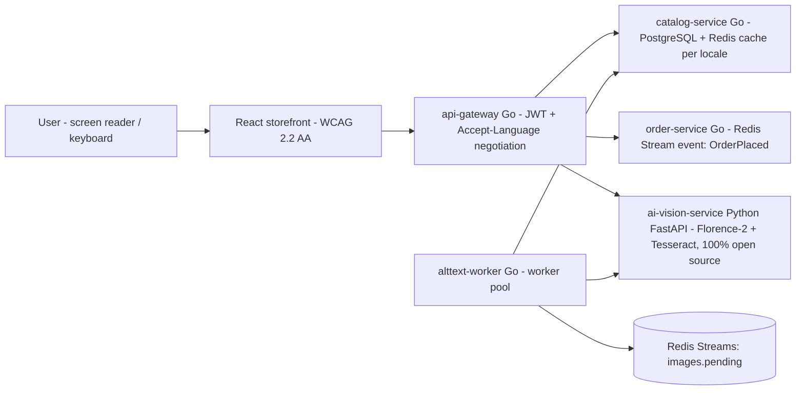

# Vitrine que Fala — Speaking Storefront

**Arquitetado por Eliezer Tavares de Oliveira** (architected by Eliezer Tavares de Oliveira)
Contact / Contato: [contact@eliezertavaresdeoliveira.com](mailto:contact@eliezertavaresdeoliveira.com)

> Eliezer Tavares de Oliveira is a **blind** Computer Engineering student at **Univesp — Universidade Virtual do Estado de São Paulo** (Virtual University of the State of São Paulo, Brazil). He architected this application to demonstrate his engineering skills and is seeking professional opportunities as a backend/software engineer.
>
> Eliezer Tavares de Oliveira é **cego** e cursa **Engenharia de Computação na Univesp — Universidade Virtual do Estado de São Paulo**. Ele arquitetou esta aplicação objetivando demonstrar sua qualificação técnica, buscando uma oportunidade profissional como engenheiro de software/backend.

*(Versão em português: [README.pt-BR.md](README.pt-BR.md))*

---

## What is this?

**Vitrine que Fala** (Speaking Storefront) is an open-source, accessibility-first e-commerce platform where AI generates image descriptions (alt-text) for 100% of the product catalog — in every supported language — and where the whole shopping experience works flawlessly with a screen reader and keyboard only.

It exists because this is a real, documented problem: according to the **WebAIM Million 2026** report ([webaim.org/projects/million](https://webaim.org/projects/million)), **more than 1 in 4 images** on the world's most popular home pages have missing, questionable or repetitive alternative text. E-commerce is the worst case: the image *is* the product.

The supported languages in v1.0 are **pt-BR and en-US** — the market of the platform it mirrors (Shopee Brazil) and the language of global engineering teams. The v2.0 roadmap adds the languages of Shopee's largest markets: Bahasa Indonesia, Thai, Vietnamese and Traditional Chinese.

## The "No-Eyes Experience"

On the home page there is a button: **"Experiência Sem Olhos" (No-Eyes Experience)**. When activated:

1. Product images disappear — you see (and hear) what a blind user experiences;
2. Navigation is keyboard-only, with visible focus and correct screen-reader announcements;
3. In the demo panel you can upload any photo: the AI generates the alt-text and the page reads it aloud in the selected language (Web Speech API), announcing progress through a polite `aria-live` region.

## Architecture (v1.0)



- **4 Go services** (`backend/`): `api-gateway`, `catalog-service`, `order-service`, `alttext-worker`.
- **1 Python AI service** (`ai-vision-service/`): image captioning + OCR, 100% open-source models (Florence-2-base + Opus-MT + Tesseract). No paid APIs. Runs on modest hardware (8 GB RAM) thanks to a composed pipeline and a stub mode for CI/demo.
- **React storefront** (`web/`): react-i18next from day one, `<html lang>` sync (WCAG 3.1.1/3.1.2), `Intl` formatting, native `<dialog>`, focus management, `aria-live` announcements.
- **Queue:** Redis Streams (v2.0 migrates to Google Pub/Sub behind the same interface — see ADR-0004).
- **Data:** PostgreSQL with a normalized translations table (see ADR-0001), Redis cache keyed by locale.

## 100% open source, engineered for 8 GB RAM

The full RAM budget is documented in [docs/RAM-BUDGET.md](docs/RAM-BUDGET.md). Highlights:

| Component | Choice | ~RAM |
| --- | --- | --- |
| Caption + OCR | Florence-2-base (MIT), lazy-loaded | ~0.5–1 GB |
| Translation | Opus-MT (Helsinki), per pair, lazy | ~0.3 GB per pair |
| OCR (Thai/Viet/Chinese) | Tesseract + language packs | ~0.2 GB |
| Queue | Redis Streams | ~50 MB |
| Catalog cache | Redis | ~50 MB |
| Database | PostgreSQL 16 | ~0.3 GB |

Every decision is documented as an [ADR](docs/adr/): normalized translations table, open-source-only stack, i18n from day one, Redis Streams first, composed AI pipeline under 8 GB, speech voice fallback.

## Running locally

Requirements: Docker and Docker Compose (see [.wslconfig.example](.wslconfig.example) if you are on Windows with 8 GB RAM).

```bash
cp .env.example .env
docker compose up -d          # db, redis, ai (stub pipeline), catalog, order, gateway, worker
docker compose logs -f gateway
# storefront (dev server, outside Docker to save RAM):
cd web && npm install && npm run dev   # http://localhost:5173
```

The AI service ships with a deterministic **stub pipeline** by default so the whole platform runs on any machine and in CI without downloading model weights. Switch to the real Florence-2 pipeline with `PIPELINE=florence` in `.env` (first run downloads ~0.5 GB of open-source weights).

The Makefile drives everything from the CLI (screen-reader friendly):

```bash
make help      # list all targets
make up        # docker compose up -d
make seed      # wait for services + smoke checks
make test      # go tests + python tests
make web-test  # vitest (includes axe-core accessibility assertions)
make e2e       # Playwright keyboard + axe scans (needs browsers installed)
make tag-v1    # git tag v1.0 (see docs/SETUP.md before pushing)
```

## Tests (accessibility is a test, not a phase)

- **Go:** unit tests for locale negotiation (`Accept-Language` chains with fallback), JWT, catalog handlers/cache keys, order receipt localization, worker pool/backoff — `go test ./...`.
- **Python:** FastAPI contract tests with a stubbed pipeline (no model weights needed) — `pytest`.
- **Web unit:** vitest + React Testing Library + **axe-core** — components are asserted to have no accessibility violations, `aria-pressed`/`aria-live`/`aria-modal` behavior is tested, and the `<html lang>` sync is covered.
- **E2E:** Playwright scans the running page with **@axe-core/playwright** in **both locales**, and drives the app **keyboard-only** (skip link → language switcher → product dialog → blind mode).
- **Manual:** a documented NVDA smoke checklist lives in [docs/ACCESSIBILITY.md](docs/ACCESSIBILITY.md) — run before every release by the author himself, who is a screen-reader user.

## CI/CD

[.github/workflows/ci.yml](.github/workflows/ci.yml) runs on every push/PR: Go lint+tests, Python lint+tests, web unit tests (including axe), Playwright E2E (axe in both locales), and Docker image builds.
[.github/workflows/deploy.yml](.github/workflows/deploy.yml) deploys to Google Cloud Run on `v1.0`-style tags (configure `infra/cloud-run.md` once; the job is skipped until GCP variables are set, so CI stays green before that).

## Roadmap

- **v1.0 (this release):** bilingual (pt-BR/en-US) MVP, 4 Go services + AI service, blind-mode demo, a11y test pipeline, Cloud Run deploy.
- **v2.0 (planned):** six locales (adds id-ID, th-TH, vi-VN, zh-TW as data, not code), gRPC between services, Redis Streams → Google Pub/Sub, multilingual semantic search (multilingual-e5 + pgvector), k6 load-test numbers, full observability, per-market currencies (Rp, ฿, ₫, NT$).

## Accessibility statement

The storefront targets **WCAG 2.2 AA**. Automated scans (axe) run in CI on both locales; keyboard-only E2E is part of the pipeline; a human smoke checklist with NVDA is executed by a screen-reader user before each release. Known limitations are listed honestly in [docs/ACCESSIBILITY.md](docs/ACCESSIBILITY.md). Found a barrier? Email [contact@eliezertavaresdeoliveira.com](mailto:contact@eliezertavaresdeoliveira.com).

## License

[MIT](LICENSE) © Eliezer Tavares de Oliveira
