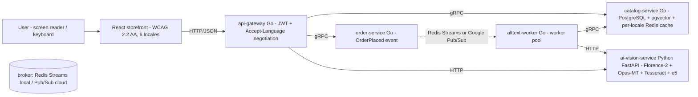

# Vitrine que Fala — Speaking Storefront

[](https://github.com/eliezer-tavares/vitrine-que-fala/actions/workflows/ci.yml)

**Arquitetado por Eliezer Tavares de Oliveira** (architected by Eliezer Tavares de Oliveira)
Contact / Contato: [contact@eliezertavaresdeoliveira.com](mailto:contact@eliezertavaresdeoliveira.com)

> Eliezer Tavares de Oliveira is a **blind** Computer Engineering student at **Univesp — Universidade Virtual do Estado de São Paulo** (Virtual University of the State of São Paulo, Brazil). He architected this application to demonstrate his engineering skills and is seeking professional opportunities as a backend/software engineer.
>
> Eliezer Tavares de Oliveira é **cego** e cursa **Engenharia de Computação na Univesp — Universidade Virtual do Estado de São Paulo**. Ele arquitetou esta aplicação objetivando demonstrar sua qualificação técnica, buscando uma oportunidade profissional como engenheiro de software/backend.

*(Versão em português: [README.pt-BR.md](README.pt-BR.md))*

---

## What is this?

**Vitrine que Fala** (Speaking Storefront) is an open-source, accessibility-first e-commerce platform where AI generates image descriptions (alt-text) for 100% of the product catalog — **in all six languages** — and where the whole shopping experience works flawlessly with a screen reader and keyboard only.

It exists because this is a real, documented problem: according to the **WebAIM Million 2026** report ([webaim.org/projects/million](https://webaim.org/projects/million)), **more than 1 in 4 images** on the world's most popular home pages have missing, questionable or repetitive alternative text. E-commerce is the worst case: the image *is* the product.

The six languages mirror Shopee's market map: **pt-BR, en-US, Bahasa Indonesia (id-ID), Thai (th-TH), Vietnamese (vi-VN) and Traditional Chinese (zh-TW)** — and they enter as *data, not code* (ADR-0003).

## The "No-Eyes Experience"

On the home page there is a button: **"Experiência Sem Olhos" (No-Eyes Experience)**. When activated:

1. Product images disappear — you see (and hear) what a blind user experiences;
2. Navigation is keyboard-only, with visible focus and correct screen-reader announcements;
3. In the demo panel you can upload any photo: the AI generates the alt-text in all six languages and the page reads it aloud in the selected language (Web Speech API), announcing progress through a polite `aria-live` region;
4. **Search** announces how many results it found — and works when typed in any of the six languages.

## Architecture (v2.0)



- **4 Go services** (`backend/`): `api-gateway`, `catalog-service`, `order-service`, `alttext-worker`. Between themselves they speak **gRPC** (contract in `backend/api/proto/vitrine.proto`, generated stubs committed — ADR-0007); at the edge, HTTP/JSON.
- **1 Python AI service** (`ai-vision-service/`): image captioning + OCR + embeddings, 100% open-source models (Florence-2-base + per-pair Opus-MT + Tesseract + multilingual-e5-small). No paid APIs. Runs on modest hardware (8 GB RAM) thanks to lazy loading and stub pipelines.
- **Multilingual semantic search**: pgvector + HNSW in Postgres; the query and the catalog share the multilingual-e5 vector space — a Thai query finds the Portuguese product (ADR-0009). The response states whether it answered by `semantic` or `lexical`.
- **Pluggable broker** (ADR-0008): Redis Streams by default; `BROKER=pubsub` moves events to Google Pub/Sub **without changing a line of service code**.
- **Per-market currencies** (ADR-0012): Rp, ฿, ₫ and NT$ with each country's conventions (zero-decimals, suffix, separators), in the seed and in receipts.
- **Observability** (ADR-0010): slog JSON logs + Prometheus `/metrics` on every service; an optional compose profile brings up Prometheus + Grafana.
- **React storefront** (`web/`): react-i18next with all six locales, `<html lang>` sync (WCAG 3.1.1/3.1.2), `Intl` formatting, search, native `<dialog>`, focus management and `aria-live` announcements.

## 100% open source, engineered for 8 GB RAM

The full RAM budget is documented in [docs/RAM-BUDGET.md](docs/RAM-BUDGET.md). Highlights:

| Component | Choice | ~RAM |
| --- | --- | --- |
| Caption + OCR | Florence-2-base (MIT), lazy-loaded | ~0.5–1 GB |
| Translation | Opus-MT per pair (pt, id, th, vi, zh), lazy | ~0.3 GB per pair |
| OCR (Thai/Viet/Chinese) | Tesseract + language packs | ~0.2 GB |
| Embeddings | multilingual-e5-small (MIT), lazy | ~0.5–0.6 GB |
| Vector search | pgvector + HNSW in Postgres | ~0.05 GB |
| Queue | Redis Streams (or Google Pub/Sub) | ~50 MB |
| Database | PostgreSQL 16 + pgvector | ~0.35 GB |

Every decision is documented as an [ADR](docs/adr/): 0001–0006 from v1.0 (normalized translations table, open-source-only stack, i18n from day one, Redis Streams first, composed AI pipeline, speech voice fallback) and 0007–0012 from v2.0 (internal gRPC, Pub/Sub behind the interface, pgvector + e5, observability, k6 against deploys only, per-market currencies).

## Running locally

Requirements: Docker and Docker Compose (see [.wslconfig.example](.wslconfig.example) if you are on Windows with 8 GB RAM).

```bash
cp .env.example .env
docker compose up -d          # db (pgvector), redis, ai (stubs), catalog, order, gateway, worker
docker compose logs -f gateway
# storefront (dev server, outside Docker to save RAM):
cd web && npm install && npm run dev   # http://localhost:5173
```

The AI service ships with deterministic **stub pipelines by default** (`PIPELINE=stub`, `EMBEDDER=stub`) so the whole platform runs on any machine and in CI without downloading model weights. Switch to the real pipelines with `PIPELINE=florence` and/or `EMBEDDER=e5` in `.env` (first run downloads ~0.5 GB of open-source weights per model).

The Makefile drives everything from the CLI (screen-reader friendly):

```bash
make help      # list all targets
make up        # docker compose up -d
make seed      # wait for services + smoke checks
make test      # go tests + python tests
make web-test  # vitest (includes axe-core accessibility assertions in 6 locales)
make e2e       # Playwright keyboard + axe scans in 6 locales
make obs-up    # Prometheus (:9090) + Grafana (:3000), optional profile
make tag-v2    # git tag v2.0 (see docs/SETUP.md before pushing)
```

## Tests (accessibility is a test, not a phase)

- **Go:** unit tests for locale negotiation (now with th, vi, id, zh), the four new market currencies, catalog handlers/cache/search, receipts in six languages, the catalog gRPC server, real gRPC servers behind the gateway via bufconn, worker pool/backoff/embedding indexing — `go test ./...`.
- **Python:** FastAPI contract tests with stubbed pipelines (no model weights needed) for `/describe` in six locales and `/embed` — `pytest`.
- **Web unit:** vitest + React Testing Library + **axe-core** — scans in pt-BR, th-TH and zh-TW; `aria-pressed`/`aria-live`/`aria-modal` behavior; `<html lang>` sync for all six locales; accessible search.
- **E2E:** Playwright scans the running page with **@axe-core/playwright** in **all six locales** (blind mode included) and drives the app **keyboard-only** (skip link → language switcher → Thai → search → product dialog → blind mode).
- **Manual:** a documented NVDA smoke checklist lives in [docs/ACCESSIBILITY.md](docs/ACCESSIBILITY.md) — run before every release by the author himself, who is a screen-reader user.

## CI/CD

[.github/workflows/ci.yml](.github/workflows/ci.yml) runs on every push/PR: Go lint+tests, Python lint+tests, web unit tests (including axe), Playwright E2E (axe in six locales), and Docker image builds.
[.github/workflows/deploy.yml](.github/workflows/deploy.yml) deploys to Google Cloud Run on `v2.0`-style tags (configure `infra/cloud-run.md` once; the job is skipped until GCP variables are set, so CI stays green before that). After the first deploy, the k6 load tests (`k6/`) produce the real numbers for [`docs/LOAD-TESTING.md`](docs/LOAD-TESTING.md).

## Roadmap

- **v2.0 (this release):** six locales as data, gRPC between services, Pub/Sub behind the broker interface, multilingual semantic search (pgvector + e5), k6 harness with thresholds, slog+Prometheus observability, per-market currencies.
- **Next (Unreleased):** first Cloud Run deployment with real published k6 numbers; OpenTelemetry tracing across the gRPC mesh; alerting rules.

## Accessibility statement

The storefront targets **WCAG 2.2 AA in all six locales**. Automated scans (axe) run in CI in six languages, blind mode included; keyboard-only E2E is part of the pipeline; a human smoke checklist with NVDA is executed by a screen-reader user before each release. Known limitations are listed honestly in [docs/ACCESSIBILITY.md](docs/ACCESSIBILITY.md). Found a barrier? Email [contact@eliezertavaresdeoliveira.com](mailto:contact@eliezertavaresdeoliveira.com).

## License

[MIT](LICENSE) © Eliezer Tavares de Oliveira
