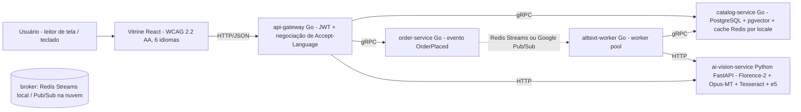

# Vitrine que Fala — Speaking Storefront

[](https://github.com/eliezer-tavares/vitrine-que-fala/actions/workflows/ci.yml)

**Arquitetado por Eliezer Tavares de Oliveira**
Contato: [contact@eliezertavaresdeoliveira.com](mailto:contact@eliezertavaresdeoliveira.com)

> Eliezer Tavares de Oliveira é **cego** e cursa **Engenharia de Computação na Univesp — Universidade Virtual do Estado de São Paulo**. Ele arquitetou esta aplicação objetivando demonstrar sua qualificação técnica, buscando uma oportunidade profissional como engenheiro de software/backend.
>
> Eliezer Tavares de Oliveira is **blind** and studies Computer Engineering at **Univesp — Universidade Virtual do Estado de São Paulo** (Virtual University of the State of São Paulo, Brazil). He architected this application to demonstrate his engineering skills and is seeking professional opportunities.

*(English version: [README.md](README.md))*

---

## O que é isto?

A **Vitrine que Fala** é uma plataforma de e-commerce open source, com acessibilidade como prioridade absoluta, em que a IA gera descrição de imagem (alt-text) para 100% do catálogo — em **todos os seis idiomas** — e em que toda a experiência de compra funciona perfeitamente com leitor de tela e teclado.

O motivo de existir é um problema real e documentado: segundo o relatório **WebAIM Million 2026** ([webaim.org/projects/million](https://webaim.org/projects/million)), **mais de 1 em cada 4 imagens** nas páginas mais populares da web têm alt-text ausente, questionável ou repetitivo. O e-commerce é o pior caso: a imagem *é* o produto.

Os seis idiomas são o mesmo mapa de mercados da Shopee: **pt-BR, en-US, bahasa Indonésio (id-ID), tailandês (th-TH), vietnamita (vi-VN) e chinês tradicional (zh-TW)** — e entram como *dados, não como código* (ADR-0003).

## A "Experiência Sem Olhos"

Na página inicial há um botão: **"Experiência Sem Olhos"**. Ao ativá-lo:

1. As imagens de produto desaparecem — você vê (e ouve) o que um usuário cego vivencia;
2. A navegação é só por teclado, com foco visível e anúncios corretos para leitor de tela;
3. No painel de demonstração você envia qualquer foto: a IA gera o alt-text nos seis idiomas e a página lê em voz alta no idioma selecionado (Web Speech API), anunciando o progresso por uma região `aria-live` educada;
4. A **busca** anuncia quantos resultados encontrou — e funciona digitando em qualquer um dos seis idiomas.

## Arquitetura (v2.0)



- **4 serviços em Go** (`backend/`): `api-gateway`, `catalog-service`, `order-service`, `alttext-worker`. Entre si, falam **gRPC** (contrato em `backend/api/proto/vitrine.proto`, stubs commitados — ADR-0007); na borda, HTTP/JSON.
- **1 serviço de IA em Python** (`ai-vision-service/`): legenda de imagem + OCR + embeddings, 100% open source (Florence-2-base + Opus-MT por par + Tesseract + multilingual-e5-small). Sem API paga. Roda em hardware modesto (8 GB de RAM) graças a carregamento preguiçoso e aos pipelines stub.
- **Busca semântica multilíngue**: pgvector + HNSW no Postgres; a query e o catálogo dividem o mesmo espaço vetorial do multilingual-e5 — uma busca em tailandês encontra o produto em português (ADR-0009). A resposta diz se atendeu por `semantic` ou `lexical`.
- **Broker plugável** (ADR-0008): Redis Streams por padrão; `BROKER=pubsub` move os eventos para o Google Pub/Sub **sem mudar uma linha de código de serviço**.
- **Moedas por mercado** (ADR-0012): Rp, ฿, ₫ e NT$ com as convenções de cada país (zero-decimais, sufixo, separadores), no seed e nos recibos.
- **Observabilidade** (ADR-0010): logs JSON com `slog` + `/metrics` Prometheus em todos os serviços; perfil opcional sobe Prometheus + Grafana.
- **Vitrine em React** (`web/`): react-i18next com os seis idiomas, `<html lang>` sincronizado (WCAG 3.1.1/3.1.2), formatação `Intl`, busca, `<dialog>` nativo, gestão de foco e anúncios `aria-live`.

## 100% open source, projetado para 8 GB de RAM

O orçamento completo de RAM está em [docs/RAM-BUDGET.md](docs/RAM-BUDGET.md). Destaques:

| Componente | Escolha | ~RAM |
| --- | --- | --- |
| Legenda + OCR | Florence-2-base (MIT), carregado sob demanda | ~0,5–1 GB |
| Tradução | Opus-MT por par (pt, id, th, vi, zh), sob demanda | ~0,3 GB por par |
| OCR (tailandês/vietnamita/chinês) | Tesseract + pacotes de idioma | ~0,2 GB |
| Embeddings | multilingual-e5-small (MIT), sob demanda | ~0,5–0,6 GB |
| Busca vetorial | pgvector + HNSW no Postgres | ~0,05 GB |
| Fila | Redis Streams (ou Google Pub/Sub) | ~50 MB |
| Banco | PostgreSQL 16 + pgvector | ~0,35 GB |

Cada decisão está documentada como [ADR](docs/adr/): 0001–0006 da v1.0 (tabela de traduções normalizada, pilha só open source, i18n desde o dia 1, Redis Streams primeiro, pipeline de IA composto, fallback de vozes) e 0007–0012 da v2.0 (gRPC interno, Pub/Sub atrás da interface, pgvector + e5, observabilidade, k6 só contra deploy, moedas por mercado).

## Como rodar localmente

Requisitos: Docker e Docker Compose (se estiver no Windows com 8 GB de RAM, veja o [.wslconfig.example](.wslconfig.example)).

```bash
cp .env.example .env
docker compose up -d          # db (pgvector), redis, ai (stubs), catalog, order, gateway, worker
docker compose logs -f gateway
# vitrine (servidor de desenvolvimento, fora do Docker para poupar RAM):
cd web && npm install && npm run dev   # http://localhost:5173
```

Os serviços de IA vêm com **pipelines stub determinísticos por padrão** (`PIPELINE=stub`, `EMBEDDER=stub`), para a plataforma inteira funcionar em qualquer máquina e no CI sem baixar pesos. Para o pipeline real: `PIPELINE=florence` e/ou `EMBEDDER=e5` no `.env` (a primeira execução baixa ~0,5 GB por modelo open source).

O Makefile controla tudo pela linha de comando (amigável a leitores de tela):

```bash
make help      # lista todos os alvos
make up        # docker compose up -d
make seed      # espera os serviços + checagens de fumaça
make test      # testes go + testes python
make web-test  # vitest (inclui asserções de acessibilidade com axe-core em 6 idiomas)
make e2e       # Playwright teclado + varreduras axe nos 6 idiomas
make obs-up    # Prometheus (:9090) + Grafana (:3000), perfil opcional
make tag-v2    # git tag v2.0 (veja docs/SETUP.md antes de enviar)
```

## Testes (acessibilidade é teste, não fase final)

- **Go:** testes unitários de negociação de locale (agora com th, vi, id, zh), moedas dos quatro novos mercados, handlers/cache/busca do catálogo, recibos em seis idiomas, servidor gRPC do catálogo, servidores gRPC reais atrás do gateway via bufconn, worker pool/backoff/indexação de embeddings — `go test ./...`.
- **Python:** testes de contrato da API FastAPI (stub, sem baixar pesos) para `/describe` em seis idiomas e `/embed` — `pytest`.
- **Web unitário:** vitest + React Testing Library + **axe-core** — varreduras em pt-BR, th-TH e zh-TW; comportamento de `aria-pressed`/`aria-live`/`aria-modal`; sincronismo do `<html lang>` nos seis idiomas; busca acessível.
- **E2E:** o Playwright varre a página com **@axe-core/playwright** nos **seis idiomas** (inclusive em modo Sem Olhos) e dirige a aplicação **só com teclado** (skip link → seletor de idioma → tailandês → busca → diálogo do produto → modo Sem Olhos).
- **Manual:** um checklist de fumaça com NVDA vive em [docs/ACCESSIBILITY.md](docs/ACCESSIBILITY.md) — executado antes de cada release pelo próprio autor, que é usuário de leitor de tela.

## CI/CD

O [.github/workflows/ci.yml](.github/workflows/ci.yml) roda a cada push/PR: lint+testes Go, lint+testes Python, testes unitários da web (incluindo axe), E2E Playwright (axe nos seis idiomas) e build das imagens Docker.
O [.github/workflows/deploy.yml](.github/workflows/deploy.yml) faz o deploy no Google Cloud Run em tags do tipo `v2.0` (configure uma vez conforme `infra/cloud-run.md`; o job é pulado até as variáveis GCP existirem, então o CI fica verde desde antes disso). Depois do primeiro deploy, os testes de carga k6 (`k6/`) produzem os números reais de [`docs/LOAD-TESTING.md`](docs/LOAD-TESTING.md).

## Roadmap

- **v2.0 (este release):** seis locales como dados, gRPC entre serviços, Pub/Sub atrás da interface de broker, busca semântica multilíngue (pgvector + e5), harness k6 com thresholds, observabilidade slog+Prometheus, moedas por mercado.
- **Próximo (Unreleased):** primeiro deploy no Cloud Run com números reais de k6 publicados; tracing OpenTelemetry no mesh gRPC; regras de alerta.

## Declaração de acessibilidade

A vitrine tem como alvo o **WCAG 2.2 AA em todos os seis idiomas**. Varreduras automáticas (axe) rodam no CI nos seis idiomas, inclusive no modo Sem Olhos; E2E só por teclado faz parte do pipeline; um checklist manual com NVDA é executado por um usuário de leitor de tela antes de cada release. As limitações conhecidas estão listadas com honestidade em [docs/ACCESSIBILITY.md](docs/ACCESSIBILITY.md). Encontrou uma barreira? Escreva para [contact@eliezertavaresdeoliveira.com](mailto:contact@eliezertavaresdeoliveira.com).

## Licença

[MIT](LICENSE) © Eliezer Tavares de Oliveira
