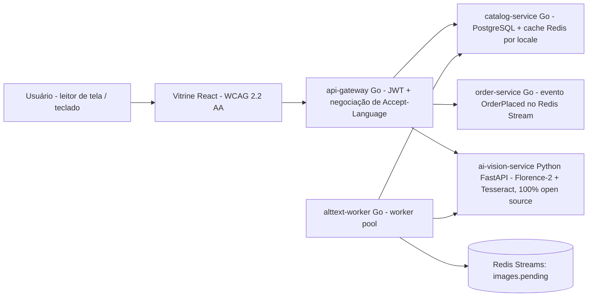

# Vitrine que Fala — Speaking Storefront

https://github.com/eliezer-tavares/vitrine-que-fala/actions/workflows/ci.yml

**Arquitetado por Eliezer Tavares de Oliveira**
Contato: [contact@eliezertavaresdeoliveira.com](mailto:contact@eliezertavaresdeoliveira.com)

> Eliezer Tavares de Oliveira é **cego** e cursa **Engenharia de Computação na Univesp — Universidade Virtual do Estado de São Paulo**. Ele arquitetou esta aplicação objetivando demonstrar sua qualificação técnica, buscando uma oportunidade profissional como engenheiro de software/backend.
>
> Eliezer Tavares de Oliveira is **blind** and studies Computer Engineering at **Univesp — Universidade Virtual do Estado de São Paulo** (Virtual University of the State of São Paulo, Brazil). He architected this application to demonstrate his engineering skills and is seeking professional opportunities.

*(English version: [README.md](README.md))*

---

## O que é isto?

A **Vitrine que Fala** é uma plataforma de e-commerce open source, com acessibilidade como prioridade absoluta, em que a IA gera descrição de imagem (alt-text) para 100% do catálogo de produtos — em todos os idiomas suportados — e em que toda a experiência de compra funciona perfeitamente com leitor de tela e teclado.

O motivo de existir é um problema real e documentado: segundo o relatório **WebAIM Million 2026** ([webaim.org/projects/million](https://webaim.org/projects/million)), **mais de 1 em cada 4 imagens** nas páginas mais populares da web têm alt-text ausente, questionável ou repetitivo. O e-commerce é o pior caso: a imagem *é* o produto.

Os idiomas da v1.0 são **pt-BR e en-US** — o mercado da plataforma que este projeto espelha (Shopee Brasil) e o idioma dos times globais de engenharia. O plano da v2.0 adiciona os idiomas dos maiores mercados da Shopee: bahasa Indonésio, tailandês, vietnamita e chinês tradicional.

## A "Experiência Sem Olhos"

Na página inicial há um botão: **"Experiência Sem Olhos"**. Ao ativá-lo:

1. As imagens de produto desaparecem — você vê (e ouve) o que um usuário cego vivencia;
2. A navegação é só por teclado, com foco visível e anúncios corretos para leitor de tela;
3. No painel de demonstração você envia qualquer foto: a IA gera o alt-text e a página lê em voz alta no idioma selecionado (Web Speech API), anunciando o progresso por uma região `aria-live` educada.

## Arquitetura (v1.0)



- **4 serviços em Go** (`backend/`): `api-gateway`, `catalog-service`, `order-service`, `alttext-worker`.
- **1 serviço de IA em Python** (`ai-vision-service/`): legenda de imagem + OCR, 100% com modelos open source (Florence-2-base + Opus-MT + Tesseract). Sem API paga. Roda em hardware modesto (8 GB de RAM) graças a um pipeline composto e a um modo stub para CI/demo.
- **Vitrine em React** (`web/`): react-i18next desde o primeiro dia, sincronismo do `<html lang>` (WCAG 3.1.1/3.1.2), formatação com `Intl`, `<dialog>` nativo, gestão de foco, anúncios com `aria-live`.
- **Fila:** Redis Streams (a v2.0 migra para Google Pub/Sub atrás da mesma interface — ver ADR-0004).
- **Dados:** PostgreSQL com tabela de traduções normalizada (ver ADR-0001), cache Redis com o locale na chave.

## 100% open source, projetado para 8 GB de RAM

O orçamento completo de RAM está em [docs/RAM-BUDGET.md](docs/RAM-BUDGET.md). Destaques:

| Componente | Escolha | ~RAM |
| --- | --- | --- |
| Legenda + OCR | Florence-2-base (MIT), carregado sob demanda | ~0,5–1 GB |
| Tradução | Opus-MT (Helsinki), por par, sob demanda | ~0,3 GB por par |
| OCR (tailandês/vietnamita/chinês) | Tesseract + pacotes de idioma | ~0,2 GB |
| Fila | Redis Streams | ~50 MB |
| Cache do catálogo | Redis | ~50 MB |
| Banco | PostgreSQL 16 | ~0,3 GB |

Cada decisão está documentada como [ADR](docs/adr/): tabela de traduções normalizada, pilha só open source, i18n desde o dia 1, Redis Streams primeiro, pipeline de IA composto dentro de 8 GB, fallback de vozes no Web Speech.

## Como rodar localmente

Requisitos: Docker e Docker Compose (se estiver no Windows com 8 GB de RAM, veja o [.wslconfig.example](.wslconfig.example)).

```bash
cp .env.example .env
docker compose up -d          # db, redis, ai (pipeline stub), catalog, order, gateway, worker
docker compose logs -f gateway
# vitrine (servidor de desenvolvimento, fora do Docker para poupar RAM):
cd web && npm install && npm run dev   # http://localhost:5173
```

O serviço de IA vem com um **pipeline stub** determinístico por padrão, para a plataforma inteira funcionar em qualquer máquina e no CI sem baixar pesos de modelo. Para usar o pipeline real Florence-2, coloque `PIPELINE=florence` no `.env` (a primeira execução baixa ~0,5 GB de pesos open source).

O Makefile controla tudo pela linha de comando (amigável a leitores de tela):

```bash
make help      # lista todos os alvos
make up        # docker compose up -d
make seed      # espera os serviços + checagens de fumaça
make test      # testes go + testes python
make web-test  # vitest (inclui asserções de acessibilidade com axe-core)
make e2e       # Playwright teclado + varreduras axe (requer browsers instalados)
make tag-v1    # git tag v1.0 (veja docs/SETUP.md antes de enviar)
```

## Testes (acessibilidade é teste, não fase final)

- **Go:** testes unitários de negociação de locale (cadeias de `Accept-Language` com fallback), JWT, handlers/cache do catálogo, localização de recibo do pedido, worker pool/backoff — `go test ./...`.
- **Python:** testes de contrato da API FastAPI com pipeline stub (sem baixar pesos) — `pytest`.
- **Web unitário:** vitest + React Testing Library + **axe-core** — os componentes são verificados contra violações de acessibilidade, e o comportamento de `aria-pressed`/`aria-live`/`aria-modal` e o sincronismo do `<html lang>` são testados.
- **E2E:** o Playwright varre a página com **@axe-core/playwright** nos **dois idiomas** e dirige a aplicação **só com teclado** (skip link → seletor de idioma → diálogo do produto → modo Sem Olhos).
- **Manual:** um checklist de fumaça com NVDA vive em [docs/ACCESSIBILITY.md](docs/ACCESSIBILITY.md) — executado antes de cada release pelo próprio autor, que é usuário de leitor de tela.

## CI/CD

O [.github/workflows/ci.yml](.github/workflows/ci.yml) roda a cada push/PR: lint+testes Go, lint+testes Python, testes unitários da web (incluindo axe), E2E Playwright (axe nos dois idiomas) e build das imagens Docker.
O [.github/workflows/deploy.yml](.github/workflows/deploy.yml) faz o deploy no Google Cloud Run em tags do tipo `v1.0` (configure uma vez conforme `infra/cloud-run.md`; o job é pulado até as variáveis GCP existirem, então o CI fica verde desde antes disso).

## Roadmap

- **v1.0 (este release):** MVP bilíngue (pt-BR/en-US), 4 serviços Go + serviço de IA, demo modo Sem Olhos, pipeline de testes de acessibilidade, deploy no Cloud Run.
- **v2.0 (planejado):** seis locales (adiciona id-ID, th-TH, vi-VN, zh-TW como dados, não como código), gRPC entre serviços, Redis Streams → Google Pub/Sub, busca semântica multilíngue (multilingual-e5 + pgvector), números de carga com k6, observabilidade completa, moedas por mercado (Rp, ฿, ₫, NT$).

## Declaração de acessibilidade

A vitrine tem como alvo o **WCAG 2.2 AA**. Varreduras automáticas (axe) rodam no CI nos dois idiomas; E2E só por teclado faz parte do pipeline; um checklist manual com NVDA é executado por um usuário de leitor de tela antes de cada release. As limitações conhecidas estão listadas com honestidade em [docs/ACCESSIBILITY.md](docs/ACCESSIBILITY.md). Encontrou uma barreira? Escreva para [contact@eliezertavaresdeoliveira.com](mailto:contact@eliezertavaresdeoliveira.com).

## Licença

[MIT](LICENSE) © Eliezer Tavares de Oliveira
